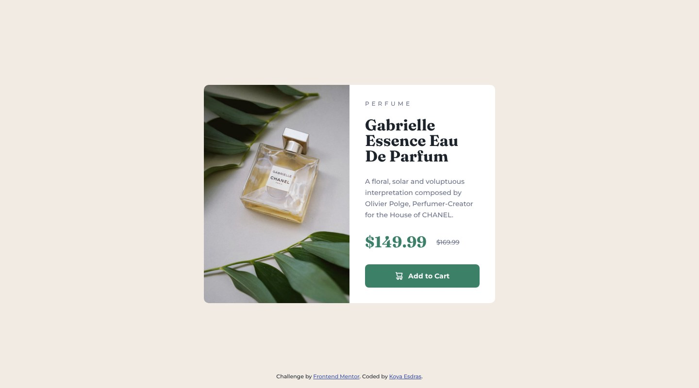

# Frontend Mentor - Product preview card component solution

This is a solution to the [Product preview card component challenge on Frontend Mentor](https://www.frontendmentor.io/challenges/product-preview-card-component-GO7UmttRfa). Frontend Mentor challenges help you improve your coding skills by building realistic projects.

## Table of contents

- [Overview](#overview)
  - [Screenshot](#screenshot)
  - [Links](#links)
- [My process](#my-process)
  - [Built with](#built-with)
  - [Workflow](#workflow)
  - [What I learned](#what-i-learned)
  - [Continued development](#continued-development)
  - [Useful resources](#useful-resources)
  - [AI Collaboration](#ai-collaboration)
- [Author](#author)

## Overview

### Screenshot



### Links

- Solution URL: [frontendmentor.io/solutions/product-preview-card-component-93Wlm6snAB](https://www.frontendmentor.io/solutions/product-preview-card-component-93Wlm6snAB)
- Live Site URL: [ounokoya.github.io/front-ui-cart](https://ounokoya.github.io/front-ui-cart/)

## My process

### Built with

- Semantic HTML5: an `article` in `main`, the category as a paragraph above the product's `h1`, the photo in a `picture` element (desktop and mobile crops) with a text alternative, the old price in `s`, and a `button type="button"` (the challenge gives it no action)
- Prices read distinctly by screen readers: "Current price: $149.99", "Original price: $169.99", with the labels visually hidden
- [Tailwind CSS v4](https://tailwindcss.com/) — design tokens in `@theme`, default palette removed, named `add-to-cart` and `link` utilities
- Montserrat and Fraunces served with the site through [Fontsource](https://fontsource.org/), Fraunces as a variable font that keeps its optical size axis
- Mobile-first: the mobile card 80 px from the top below 640 px, the desktop card centred from 640 px
- [Vite](https://vite.dev/) for the build, deployed on GitHub Pages from the `gh-pages` branch (`npm run deploy`)
- [Playwright](https://playwright.dev/), [axe-core](https://github.com/dequelabs/axe-core), the W3C Nu validator, html-validate and ESLint for tests

### Workflow

This is version 2 of my 2023 solution, rebuilt from the current starter in the same repository. Before any code, the design was analysed and rebuilt:

1. **Visual analysis in Excalidraw** — measurements in px, contrast checks, the HTML tree → [`specs/visuel/`](./specs/visuel/)
2. **Penpot mockup** — library, desktop, hover, mobile and tablet screens, visual thresholds calibrated against the design JPGs → [`specs/visuel/penpot/`](./specs/visuel/penpot/)
3. **Spec, then tests** — 21 Given/When/Then scenarios and the accessible names the tests rely on → [`specs/specifications/`](./specs/specifications/); the tests were written before the code and checked to fail on the starter
4. **Decisions** — tokens, fonts, the photo, prices and button, the layout → [`specs/adr/`](./specs/adr/)
5. **Code**, then a walk-through in a real browser → [`specs/analyse/`](./specs/analyse/)

### What I learned

**A strikethrough is silent.** Screen readers do not announce `text-decoration: line-through`, so "$149.99 $169.99" would sound like two prices. Visually hidden labels make the meaning explicit:

```html
<p>
  <span class="sr-only">Current price: </span><span>$149.99</span>
  <s><span class="sr-only">Original price: </span><span>$169.99</span></s>
</p>
```

**Optical size matters for Fraunces.** Fraunces is a variable font with an optical size axis; the design's 32 px headings match it only with that axis. `@fontsource-variable/fraunces/opsz` keeps it, and the browser picks the optical size from the font size.

**Give each visible value its own element.** With the hidden label inside the same `span`, no element had "$149.99" as its text; one `span` per price keeps both the styles and the tests simple.

### Continued development

- **Visual comparison with the design files.** Screenshots differ from the Frontend Mentor JPGs by 0.60 % (desktop), 0.61 % (hover state) and 2.37 % (mobile) of pixels, for a 5 % threshold.
- **Tablet**: my own proposal, the desktop card centred from 640 px.

### Useful resources

- [MDN — `<s>`](https://developer.mozilla.org/en-US/docs/Web/HTML/Reference/Elements/s) — text that is no longer accurate, and why it needs a label for screen readers.
- [MDN — `font-optical-sizing`](https://developer.mozilla.org/en-US/docs/Web/CSS/font-optical-sizing) — automatic optical size.
- [MDN — `<picture>`](https://developer.mozilla.org/en-US/docs/Web/HTML/Reference/Elements/picture) — a different crop for each width.

### AI Collaboration

I used **Claude (Claude Code)** as a pair, inside my own spec-driven workflow where I validated each step before the next one:

- **Planning**: Claude listed my old solutions that needed a rebuild and wrote the plan, which I validated.
- **Design analysis and mockup**: Claude measured the JPG designs, drew the annotated Excalidraw analysis and built the Penpot mockup; I reviewed both and decided on the button markup, the price labels, the photo's text alternative, the headings, the tablet layout and the Fraunces version.
- **Spec and tests**: written by Claude before any code, from the validated mockup.
- **Technical decisions**: fonts from Fontsource, as in my earlier solutions without font files in the starter.
- **Code**: written by Claude from the spec — I confirmed this split at the code lock — with the tests run at each step.

What worked well: comparing the page with the design pixel by pixel explained every difference before it was fixed. What needed my decisions: the choices listed above.

## Author

- Frontend Mentor - [@ounokoya](https://www.frontendmentor.io/profile/ounokoya)
- GitHub - [@ounokoya](https://github.com/ounokoya)
